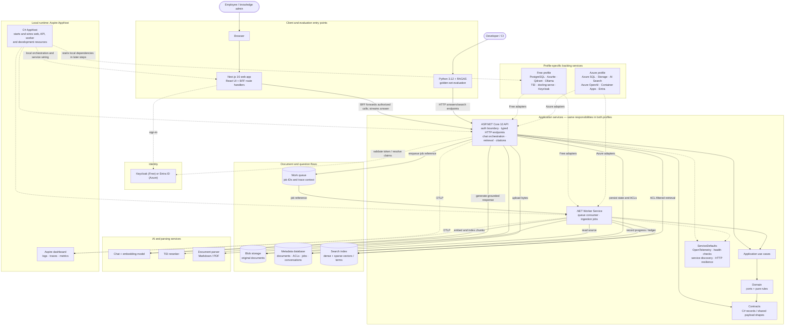
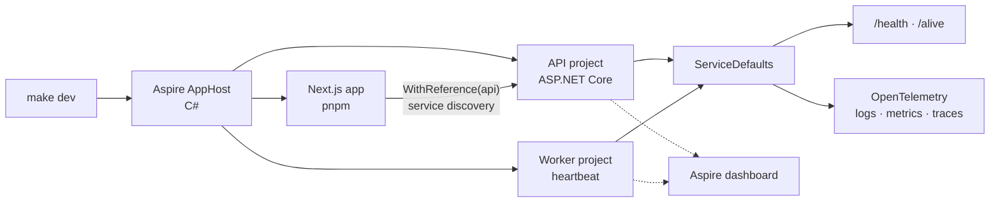

# Project overview

Knowledge Copilot is a permission-aware retrieval-augmented generation (RAG)
application for internal knowledge. A user asks a question; the system searches
only documents that user's tenant and principals are allowed to access, then
returns a grounded answer with citations. The intended product also supports
structured UI widgets and human-approved actions.

This page explains both the **architecture being built toward** and the
**implementation state today**. The repository's architecture document is the
complete design; this is the guided explanation of how its pieces fit and why.

## Where the project is now

The repository is at the boundary between the first two roadmap steps:

| Step | Status | What exists or is being added |
| --- | --- | --- |
| [0 — Scaffold and quality gates](steps/step-00-scaffold.md) | Implemented | .NET solution, Aspire AppHost, ASP.NET Core API host, .NET Worker host, shared ServiceDefaults, minimal Next.js app, Python evals skeleton, CI, tests, and Makefile. |
| [1 — Contracts and codegen](steps/step-01-contracts.md) | Planned next | C# contract records become the source for OpenAPI/JSON Schema, generated TypeScript and zod schemas, and generated Python/Pydantic models. |

The running Step 0 code is deliberately a skeleton: the API and worker expose
health/liveness endpoints and the worker runs a heartbeat service. The
Contracts, Domain, and Application projects exist but are not yet feature
implementations. Document ingestion, retrieval, authentication, model calls,
and the metadata database are later steps.

## Architecture at a glance

The diagram shows the intended end state for local development and Azure. The
same web, API, and worker responsibilities are used in both profiles; only the
adapters and backing services change. Dashed/dotted boundaries distinguish
deployment and telemetry relationships from application data flow.

### The main request paths

**Question answering:** the browser talks to Next.js. The Next.js
backend-for-frontend (BFF) owns the OIDC session and forwards requests to the
API; the browser does not hold the access token. The API obtains the caller's
tenant, user, and group principals from validated identity—not from a request
body. Retrieval pushes tenant and ACL filters into the index query before
results are returned. The API reranks allowed chunks, fences retrieved text as
untrusted prompt data, generates an answer, validates citations against the
retrieved set, and streams the result to the UI.

**Document ingestion:** an administrator uploads a document and its ACL. The
API stores the original in blob storage, records document/ACL/job state in the
metadata database, and places a small job reference on the queue. The worker
loads the job and blob, parses and chunks the document, embeds chunks, and
updates the search index and ledger. Queue messages carry identifiers rather
than document text or ACL data; jobs are designed to be idempotent and
at-least-once.

**Evaluation:** the Python harness exercises the product through HTTP rather
than importing internal .NET code. That tests the same public boundary that
other clients use and allows profile-specific retrieval and answer quality to
be measured against a common golden set.

## What ASP.NET Core, Aspire, and containers each do

These are complementary layers, not competing ways to build the app:

| Technology | Responsibility | In this project |
| --- | --- | --- |
| ASP.NET Core | Runs the HTTP API: routing, middleware, dependency injection, configuration, health routes, and (later) OpenAPI and streaming endpoints. | `KnowledgeCopilot.Api` is an ASP.NET Core web host. ASP.NET Core does not itself package or orchestrate the service as a container. |
| .NET Worker Service | Runs long-lived background processing without an HTTP request per job. | `KnowledgeCopilot.Worker` is a separate .NET host for queue-driven ingestion. It currently has a heartbeat, not the future ingestion pipeline. |
| Aspire AppHost | Describes the local distributed application in C#: which projects/resources run, how they are named, configured, referenced, and made ready. It also supplies local service discovery and developer observability through the dashboard. | `KnowledgeCopilot.AppHost` launches the API, worker, and Next.js app. It configures the local `Free` profile and wires the web app to the API. |
| Aspire ServiceDefaults | Adds common service-level capabilities to each .NET host. | API and worker share health checks, OpenTelemetry instrumentation/export, service discovery, standard HTTP resilience, logging, and validated profile options. |
| Containers | Package an application and its runtime/dependencies into an image that can be run consistently by a container runtime or platform. | The current Step 0 app projects are started by Aspire for development; Dockerfiles and Docker Compose are explicitly deferred to Step 10. Azure Container Apps is deferred to Step 11. |

At development time, the AppHost is the **orchestrator**; ASP.NET Core and the
Worker Service are the **application processes**. Aspire does not replace
ASP.NET Core, and ASP.NET Core does not replace a container runtime. In later
packaging/deployment steps, the same API and worker responsibilities will be
published as images; Docker Compose can run the Free stack locally, while Azure
Container Apps can host the managed profile. Aspire's resource model, service
references, health checks, and telemetry help make those services observable
and connected, but do not make the code itself containerized.

The Aspire dashboard is for development-time diagnostics. OpenTelemetry is
instrumented in the services and exported over OTLP when an endpoint is
configured; the dashboard receives that telemetry in the local Aspire setup.
Health endpoints are also mapped in every environment because container
platform probes need them after deployment.

## How the current scaffold runs

`make dev` prefers `aspire run` and falls back to `dotnet run` on the AppHost.
The AppHost sets `KnowledgeCopilot:Profile=Free` for the API and worker and
declares health checks for API and web. At this stage, it does not declare
PostgreSQL, Azurite, Qdrant, Ollama, Keycloak, or other infrastructure
containers. Those services appear in the target architecture and are added by
later implementation steps.

## Why the architecture is shaped this way

- **One core, two profiles:** Domain rules and Application use cases depend on
  ports rather than Qdrant, Azure, or other vendor SDKs. The API and worker
  composition roots choose Free or Azure adapters. This keeps the core portable
  and makes permissions and business rules shared instead of duplicated.
- **Security before convenience:** tenant and ACL filters are part of every
  index query, identity comes from validated server-side claims, retrieved
  text is untrusted, and side-effecting tools require server-verified
  approvals. The design prevents unauthorized results from being fetched and
  then filtered too late.
- **One contract source:** Step 1 makes C# records the owner of cross-process
  payloads and generates the OpenAPI/schema artifacts and TypeScript/Python
  types. A CI drift check catches forgotten regeneration instead of letting
  language-specific copies diverge.
- **Separate online and background work:** the API can acknowledge document
  uploads quickly while the worker handles parsing and indexing independently.
  Queue retries and idempotent processing make transient failures manageable.
- **Observable by default:** common ServiceDefaults and OpenTelemetry give the
  API and worker consistent health, logs, metrics, traces, resilience, and
  service discovery instead of bespoke setup in each host.
- **A local-to-cloud path:** Free uses local OSS-compatible services and Azure
  uses managed services. The shared ports and deployment profiles make the
  swap explicit and testable rather than spreading environment-specific
  branches throughout feature code.
- **A measured learning project:** staged steps keep each PR bounded. Tests,
  generated artifacts, decision records, and evaluation gates make the
  architecture verifiable as it grows.

## The first two steps in context

### Step 0 — establish a dependable runtime

Step 0 pins the .NET 10 SDK and Aspire AppHost SDK, creates the solution and
initial hosts, shares operational defaults, and provides a single `Makefile`
entry point for setup, build, lint, test, and local development. The web and
Python projects are minimal scaffolds. CI runs those same quality gates.
There are intentionally no real RAG features or infrastructure services yet.

This foundation reduces variation between local development and CI and gives
later steps a place to add services without first solving the build/run
workflow.

### Step 1 — define boundary payloads once

Step 1 will add the payload records to `KnowledgeCopilot.Contracts`, then
generate OpenAPI 3.1 and JSON Schema, TypeScript types and zod validators, and
Python/Pydantic models. Shared fixtures and tests will verify that valid
payloads round-trip and invalid ones are rejected. CI will regenerate the
artifacts and fail on a diff.

This makes the public API and the future web/evaluation clients agree on
required fields, nullability, and widget variants before endpoints gain
behavior. It deliberately does not add persistence, domain behavior,
authentication, or working endpoints; those are later steps.

For the complete design and decision rationale, see
[architecture.md](architecture.md), [decisions.md](decisions.md), and the
[step roadmap](steps/README.md).
